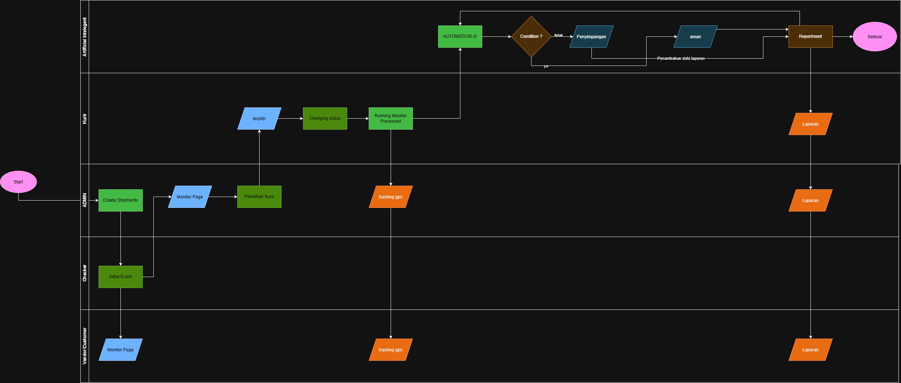

# Pharma Logistics Workflow Architecture
## Anteraja NextGen AI — Central Documentation Hub

Dokumentasi resmi arsitektur sistem, persyaratan produk (*Product Requirement Document* / PRD), spesifikasi fungsional (*Functional Requirement Document* / FRD), serta diagram alur operasional logistik farmasi (*cold-chain*) untuk tim pengembang Anteraja Pharma.

---

## 📁 Struktur Direktori `docs/`

Struktur folder dokumentasi telah ditata secara modular agar mudah ditelusuri dan dipelihara:

```
docs/
├── README.md                                  # Hub & Indeks Utama Dokumentasi (file ini)
├── prd/
│   └── PRD-pharma-logistics.md                # Dokumen PRD Utama (Hackathon Edition)
├── frd/
│   ├── FRD-01-manajemen-pengiriman.md         # Inisiasi Pengiriman & Setup Threshold Suhu
│   ├── FRD-02-pemeriksaan-barang.md           # Pemeriksaan Barang (Initial Exam) & AI Vision
│   ├── FRD-03-penugasan-dan-pelacakan-kurir.md# Penugasan Kurir, Live GPS Tracking & WA
│   ├── FRD-04-automasi-ai-dan-penyimpangan.md # Automasi AI, Deteksi Anomali & Predictive Cold-Chain
│   ├── FRD-05-pelaporan-dan-penutupan.md      # Auto-Report PDF/BAP & Penutupan Pengiriman
│   └── FRD-06-control-panel-simulator.md      # Control Panel Simulator (Hackathon Demo Mode)
├── database/
│   └── schema.md                              # Skema Database, Kamus Data & Relasi ERD
├── diagrams/
│   └── flowchart.png                          # Diagram Alur Kerja Sistem (Workflow Architecture)
└── references/
    └── Business_Acumen_Pharma_Anteraja.pdf    # Dokumen Acuan Bisnis & Kepatuhan Farmasi (CPOB/GDP)
```

---

## 📑 Daftar Dokumen Utama

### 1. Product Requirement Document (PRD)
* **[PRD-pharma-logistics.md](./prd/PRD-pharma-logistics.md)**: Dokumen komprehensif yang menguraikan visi produk, ringkasan eksekutif, analisis peran stakeholder, arsitektur teknologi, serta peta jalan (roadmap) 4-hari hackathon.

### 2. Functional Requirement Documents (FRD)
Sistem dipecah ke dalam 6 modul fungsional terintegrasi:

| Modul | Nama Dokumen | Fokus & Tanggung Jawab Utama | Aktor Utama |
| :--- | :--- | :--- | :--- |
| **FR-01** | [FRD-01: Manajemen Pengiriman](./frd/FRD-01-manajemen-pengiriman.md) | Inisiasi resi, konfigurasi batas suhu (`temp_min`/`temp_max`), dan pemicuan tugas awal. | Admin |
| **FR-02** | [FRD-02: Pemeriksaan Barang](./frd/FRD-02-pemeriksaan-barang.md) | Pemeriksaan fisik hub gudang (*Initial Exam*), upload bukti segel/suhu, dan verifikasi AI Vision. | Checker, Admin |
| **FR-03** | [FRD-03: Penugasan & Pelacakan Kurir](./frd/FRD-03-penugasan-dan-pelacakan-kurir.md) | Alokasi kurir, konfirmasi penerimaan, pemancaran telemetry, dan live GPS tracking map. | Admin, Kurir, Customer |
| **FR-04** | [FRD-04: Automasi AI & Penyimpangan](./frd/FRD-04-automasi-ai-dan-penyimpangan.md) | Evaluasi telemetry *stream*, deteksi lonjakan suhu/kerusakan segel, dan *Predictive Cold-Chain Alert*. | Automation AI, Admin |
| **FR-05** | [FRD-05: Pelaporan & Penutupan](./frd/FRD-05-pelaporan-dan-penutupan.md) | Penyusunan otomatis Berita Acara Pemeriksaan (BAP) PDF dan distribusi paralel via WA/Email. | Automation AI, Semua Aktor |
| **FR-06** | [FRD-06: Control Panel Simulator](./frd/FRD-06-control-panel-simulator.md) | Panel kendali simulasi demo hackathon (suhu melonjak, signal drop, fast-forward timeline). | Presenter / Demo Ops |

### 3. Skema Database & ERD
* **[schema.md](./database/schema.md)**: Dokumentasi teknis struktur basis data PostgreSQL/Supabase, diagram relasi entitas (*ERD*), kamus data lengkap (*data dictionary*), kunci unik/indeks, status enum, serta pola integritas data CPOB (*append-only audit trail* & *optimistic locking*).

### 4. Diagram Arsitektur & Alur Kerja
* **[flowchart.png](./diagrams/flowchart.png)**: Diagram arsitektur visual alur kerja interaksi antara Admin, Checker, Kurir, Customer, dan Automation AI Engine.



### 5. Dokumen Referensi Bisnis
* **[Business_Acumen_Pharma_Anteraja.pdf](./references/Business_Acumen_Pharma_Anteraja.pdf)**: Pedoman kepatuhan regulasi farmasi, prinsip Cara Pembuatan Obat yang Baik (CPOB), dan analisis *business impact*.

---

## 🔄 Siklus Hidup & Status Pengiriman (State Machine)

```
[Start: Admin Create Shipment]
               │
               ▼
   `CREATED_AWAITING_EXAM` ──► Checker melakukan Initial Exam
               │
               ▼
  `EXAMINED_PENDING_APPROVAL` ──► Admin Review di Monitor Page
       ├── [Tahan]  ──► `HELD_FOR_INSPECTION`
       └── [Setujui] ──► `APPROVED_READY_FOR_ASSIGNMENT`
                               │
                               ▼ Admin menugaskan kurir
                   `ASSIGNED_COURIER_ACCEPTED`
                               │
                               ▼ Kurir mulai pengantaran
                          `IN_TRANSIT`
                               │
          ┌────────────────────┴────────────────────┐
          ▼                                         ▼
   [Telemetry Normal]                    [Terdeteksi Anomali]
          │                                         │
          │                                         ▼
          │                                 `DEVIATION_HOLD`
          │                                         │ (Admin intervensi & input alasan)
          │                                         ▼
          └────────────────────┬────────────────────┘
                               │
                               ▼
                          `DELIVERED`
                               │
                               ▼ Sistem menerbitkan PDF Laporan Akhir & BAP
                      `COMPLETED_CLOSED`
```

---

## 🛡️ Matriks Hak Akses (Role-Based Access Control)

| Fitur / Modul | ADMIN | Checker | Vendor / Customer | Kurir | AUTOMATION AI |
| :--- | :---: | :---: | :---: | :---: | :---: |
| **Create Shipment & Setup Handling** | ✅ Write | ❌ | ❌ | ❌ | ❌ |
| **Execute Initial Exam & Upload Proof** | ❌ | ✅ Write | ❌ | ❌ | ❌ |
| **Review Exam & Give Approval** | ✅ Write | ❌ | ❌ | ❌ | ❌ |
| **Courier Assignment** | ✅ Write | ❌ | ❌ | ❌ | ❌ |
| **Accept / Reject Assignment** | ❌ | ❌ | ❌ | ✅ Write | ❌ |
| **Update Transit Status & Emit Telemetry** | ❌ | ❌ | ❌ | ✅ Write | ❌ |
| **View Live GPS Tracking & Temp Chart** | ✅ Read | ❌ | ✅ Read | ✅ Read | ✅ Read |
| **Report Field Incident** | ❌ | ❌ | ❌ | ✅ Write | ❌ |
| **Evaluate Anomaly & Trigger Predictive Alert** | ❌ | ❌ | ❌ | ❌ | ✅ Execute |
| **Resolve Incident & Enter Reason Notes** | ✅ Write | ❌ | ❌ | ❌ | ❌ |
| **Generate & Receive Final PDF Report** | ✅ Read | ❌ | ✅ Read | ✅ Read | ✅ Execute |
| **Trigger Demo Simulator (Hackathon Mode)** | ✅ Write | ❌ | ❌ | ❌ | ❌ |

---

## 🌟 Fitur Pembeda Unggulan (Key Differentiators)

1. **AI Vision Inspection (FR-02)**: Pemindaian cerdas terhadap kondisi fisik segel dan pembacaan digit suhu pada termometer analog/digital menggunakan AI Vision / OCR.
2. **Predictive Cold-Chain Engine (FR-04)**: Evaluasi laju kenaikan suhu (*temperature velocity*) untuk memberikan peringatan dini sebelum obat mengalami degradasi mutu.
3. **Control Panel Simulator (FR-06)**: Panel kendali live demo hackathon untuk menguji respons sistem terhadap skenario darurat dalam hitungan detik.
4. **Auto-Report & Parallel Multi-Channel Distribution (FR-05)**: Berita Acara Pemeriksaan (BAP) terbit otomatis berstandar GDP/CPOB dan terdistribusi via WhatsApp, Telegram, dan PDF download.
