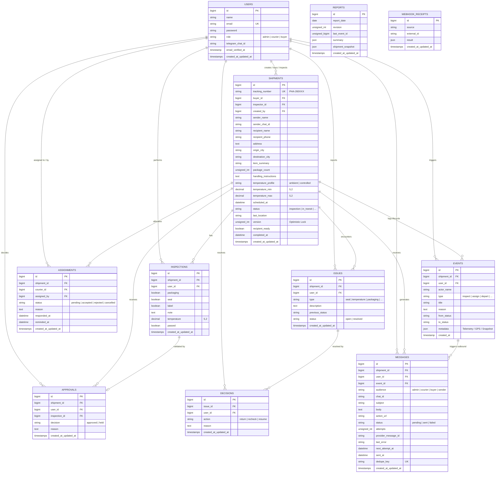

# Skema Database (Database Schema) & ERD
## Anteraja NextGen AI — Pharma Cold-Chain Logistics

Dokumentasi komprehensif skema database relasional (*PostgreSQL / Supabase*), kamus data (*data dictionary*), relasi antar tabel (*Entity-Relationship Diagram*), serta pola integritas data untuk sistem logistik farmasi Anteraja Pharma.

---

## 📌 Ringkasan Arsitektur Database

* **Database Engine**: PostgreSQL 15+ (Hosted on Supabase Cloud)
* **ORM & Driver**: Laravel 11 Eloquent ORM (`pgsql`)
* **Karakteristik Desain**:
  1. **Audit Trail Mutlak (CPOB / GDP Compliance)**: Setiap perubahan status kiriman mencatat *immutable log* pada tabel `events` dengan rekaman aktor, status sebelum/sesudah, alasan (*reason*), dan payload JSONB.
  2. **Optimistic Locking**: Kolom `version` pada tabel `shipments` mencegah *race condition* saat Admin, Kurir (Satria), dan Otomasi AI mengakses dan memperbarui status secara bersamaan.
  3. **Idempotensi & Anti-Duplikasi**: Kolom `dedupe_key` pada `messages` serta `(source, external_id)` pada `webhook_receipts` menjamin pesan dan webhook tidak diproses ganda.
  4. **Daily Snapshot Versioning**: Tabel `reports` menggunakan kunci komposit unik `(report_date, revision)` untuk menyimpan rekam jejak kepatuhan suhu harian.

---

## 📊 Entity-Relationship Diagram (ERD)



---

## 🗄️ Kamus Data Lengkap (Data Dictionary)

### 1. Tabel `users`
Menyimpan identitas seluruh stakeholder sistem, hak akses (*role*), dan kredensial integrasi bot komunikasi (Telegram).

| Nama Kolom | Tipe Data | Nullable | Default | Keterangan & Aturan |
| :--- | :--- | :---: | :---: | :--- |
| `id` | `BIGINT` | ❌ | *Auto Increment* | Primary Key akun pengguna |
| `name` | `VARCHAR(255)` | ❌ | - | Nama lengkap stakeholder (Admin, Satria, Pembeli) |
| `email` | `VARCHAR(255)` | ❌ | - | Email unik untuk autentikasi login (`UNIQUE`) |
| `email_verified_at`| `TIMESTAMP` | ✅ | `NULL` | Waktu verifikasi email |
| `password` | `VARCHAR(255)` | ❌ | - | Password ter-hash menggunakan algoritma Bcrypt/Argon2 |
| `role` | `VARCHAR(255)` | ❌ | `'buyer'` | Peran pengguna: `'admin'`, `'courier'`, `'buyer'`. Terindeks (`INDEX`). |
| `telegram_chat_id` | `VARCHAR(255)` | ✅ | `NULL` | ID Chat Telegram penerima notifikasi otomatis |
| `remember_token` | `VARCHAR(100)` | ✅ | `NULL` | Token sesi "Ingat Saya" (Laravel Auth) |
| `created_at` | `TIMESTAMP` | ✅ | `NULL` | Waktu pendaftaran akun |
| `updated_at` | `TIMESTAMP` | ✅ | `NULL` | Waktu pembaruan profil akun |

---

### 2. Tabel `shipments`
Entitas inti (*aggregate root*) yang merepresentasikan satu paket obat farmasi berpendingin beserta seluruh parameter kepatuhan cold-chain.

| Nama Kolom | Tipe Data | Nullable | Default | Keterangan & Aturan |
| :--- | :--- | :---: | :---: | :--- |
| `id` | `BIGINT` | ❌ | *Auto Increment* | Primary Key pengiriman |
| `tracking_number` | `VARCHAR(255)` | ❌ | - | Nomor resi unik (format: `PHA-260XXX`) (`UNIQUE`) |
| `buyer_id` | `BIGINT` | ❌ | - | Foreign Key ke `users.id` (Pembeli / Penerima Fasilitas Medis) |
| `inspector_id` | `BIGINT` | ❌ | - | Foreign Key ke `users.id` (Checker / Kurir pemeriksa awal) |
| `created_by` | `BIGINT` | ❌ | - | Foreign Key ke `users.id` (Admin pembuat pengiriman) |
| `sender_name` | `VARCHAR(255)` | ❌ | - | Nama distributor / gudang farmasi pengirim |
| `sender_chat_id` | `VARCHAR(255)` | ✅ | `NULL` | ID bot chat pihak pengirim |
| `recipient_name` | `VARCHAR(255)` | ❌ | - | Nama fasilitas penerima (Apotek, Rumah Sakit, Klinik) |
| `recipient_phone` | `VARCHAR(255)` | ❌ | - | Kontak darurat penerima |
| `address` | `TEXT` | ❌ | - | Alamat detail tujuan pengiriman |
| `origin_city` | `VARCHAR(255)` | ❌ | - | Kota asal keberangkatan |
| `destination_city` | `VARCHAR(255)` | ❌ | - | Kota tujuan pengantaran |
| `item_summary` | `VARCHAR(255)` | ❌ | - | Ringkasan muatan obat / vaksin / reagen |
| `package_count` | `UNSIGNED INT` | ❌ | `1` | Jumlah koli / kotak kargo |
| `handling_instructions` | `TEXT` | ❌ | - | Instruksi penanganan khusus CPOB (misal: "Jangan dibalik") |
| `temperature_profile` | `VARCHAR(255)` | ❌ | `'ambient'` | Profil suhu: `'ambient'` (15–25°C) atau `'controlled'` (2–8°C) |
| `temperature_min` | `DECIMAL(5,2)` | ✅ | `NULL` | Batas bawah suhu aman (°C) jika profil controlled |
| `temperature_max` | `DECIMAL(5,2)` | ✅ | `NULL` | Batas atas suhu aman (°C) jika profil controlled |
| `scheduled_at` | `DATETIME` | ❌ | - | Jadwal batas waktu pengiriman tiba |
| `status` | `VARCHAR(255)` | ❌ | `'inspection'` | Status siklus pengiriman (`INDEX`). Lihat daftar status di bawah. |
| `last_location` | `VARCHAR(255)` | ❌ | - | Titik lokasi terakhir (Hub Cakung, On Transit, dll.) |
| `version` | `UNSIGNED INT` | ❌ | `1` | Nomor versi optimis (*Optimistic Locking*) |
| `recipient_ready` | `BOOLEAN` | ✅ | `NULL` | Konfirmasi kesiapan penerima via portal (`true`/`false`) |
| `completed_at` | `DATETIME` | ✅ | `NULL` | Waktu pengiriman selesai diserahterimakan / diretur |
| `created_at` | `TIMESTAMP` | ✅ | `NULL` | Waktu pencatatan pengiriman |
| `updated_at` | `TIMESTAMP` | ✅ | `NULL` | Waktu perubahan terakhir |

> **Index Tambahan**:
> * `INDEX shipments_buyer_id_status_index (buyer_id, status)` untuk efisiensi filter dashboard pembeli.

---

### 3. Tabel `inspections`
Menyimpan hasil pemeriksaan fisik (*Initial Exam*) di hub gudang sebelum barang diizinkan keluar.

| Nama Kolom | Tipe Data | Nullable | Default | Keterangan & Aturan |
| :--- | :--- | :---: | :---: | :--- |
| `id` | `BIGINT` | ❌ | *Auto Increment* | Primary Key riwayat pemeriksaan |
| `shipment_id` | `BIGINT` | ❌ | - | Foreign Key ke `shipments.id` |
| `user_id` | `BIGINT` | ❌ | - | Foreign Key ke `users.id` (Checker yang memeriksa) |
| `packaging` | `BOOLEAN` | ❌ | - | Kondisi boks/styrofoam utuh tanpa cacat (`true`/`false`) |
| `seal` | `BOOLEAN` | ❌ | - | Kondisi segel keamanan utuh (`true`/`false`) |
| `label` | `BOOLEAN` | ❌ | - | Label barcode & instruksi suhu terpasang jelas (`true`/`false`) |
| `note` | `TEXT` | ❌ | - | Catatan visual / temuan pemeriksaan fisik |
| `temperature` | `DECIMAL(5,2)` | ✅ | `NULL` | Angka suhu terukur saat pemeriksaan (°C) |
| `passed` | `BOOLEAN` | ❌ | - | Hasil akhir lolos uji (*semua checklist true & suhu in-range*) |
| `created_at` | `TIMESTAMP` | ✅ | `NULL` | Waktu pelaksanaan inspeksi |
| `updated_at` | `TIMESTAMP` | ✅ | `NULL` | Waktu perubahan data |

> **Index Tambahan**:
> * `INDEX inspections_shipment_id_id_index (shipment_id, id)` untuk query inspeksi terbaru secara cepat.

---

### 4. Tabel `approvals`
Mencatat persetujuan (*approval*) atau penahanan (*hold*) resmi oleh Admin terhadap hasil inspeksi.

| Nama Kolom | Tipe Data | Nullable | Default | Keterangan & Aturan |
| :--- | :--- | :---: | :---: | :--- |
| `id` | `BIGINT` | ❌ | *Auto Increment* | Primary Key persetujuan |
| `shipment_id` | `BIGINT` | ❌ | - | Foreign Key ke `shipments.id` |
| `user_id` | `BIGINT` | ❌ | - | Foreign Key ke `users.id` (Admin yang menyetujui) |
| `inspection_id` | `BIGINT` | ✅ | `NULL` | Foreign Key ke `inspections.id` yang menjadi rujukan |
| `decision` | `VARCHAR(255)` | ❌ | - | Keputusan Admin: `'approved'` atau `'held'` |
| `reason` | `TEXT` | ❌ | - | Alasan atau instruksi khusus dari Admin |
| `created_at` | `TIMESTAMP` | ✅ | `NULL` | Waktu persetujuan diterbitkan |
| `updated_at` | `TIMESTAMP` | ✅ | `NULL` | Waktu pembaruan data |

---

### 5. Tabel `assignments`
Mencatat alokasi tugas pengantaran kepada Satria (Kurir) dan respons penerimaan tugas.

| Nama Kolom | Tipe Data | Nullable | Default | Keterangan & Aturan |
| :--- | :--- | :---: | :---: | :--- |
| `id` | `BIGINT` | ❌ | *Auto Increment* | Primary Key penugasan |
| `shipment_id` | `BIGINT` | ❌ | - | Foreign Key ke `shipments.id` |
| `courier_id` | `BIGINT` | ❌ | - | Foreign Key ke `users.id` (Kurir yang ditugaskan) |
| `assigned_by` | `BIGINT` | ❌ | - | Foreign Key ke `users.id` (Admin yang memberi tugas) |
| `status` | `VARCHAR(255)` | ❌ | `'pending'` | Status penugasan: `'pending'`, `'accepted'`, `'rejected'`, `'cancelled'` (`INDEX`) |
| `reason` | `TEXT` | ✅ | `NULL` | Alasan penolakan / pembatalan penugasan |
| `responded_at` | `DATETIME` | ✅ | `NULL` | Waktu kurir merespons tugas |
| `reminded_at` | `DATETIME` | ✅ | `NULL` | Waktu sistem mengirim peringatan keterlambatan respons |
| `created_at` | `TIMESTAMP` | ✅ | `NULL` | Waktu tugas dibuat |
| `updated_at` | `TIMESTAMP` | ✅ | `NULL` | Waktu status tugas berubah |

> **Index Tambahan**:
> * `INDEX assignments_courier_id_status_index (courier_id, status)` untuk filter tugas kurir aktif.

---

### 6. Tabel `issues`
Menyimpan insiden atau anomali (*deviation*) yang terjadi selama perjalanan atau pemeriksaan fisik.

| Nama Kolom | Tipe Data | Nullable | Default | Keterangan & Aturan |
| :--- | :--- | :---: | :---: | :--- |
| `id` | `BIGINT` | ❌ | *Auto Increment* | Primary Key kendala |
| `shipment_id` | `BIGINT` | ❌ | - | Foreign Key ke `shipments.id` |
| `user_id` | `BIGINT` | ❌ | - | Foreign Key ke `users.id` (Pelapor kendala: kurir/pembeli) |
| `type` | `VARCHAR(255)` | ❌ | - | Jenis kendala: `'seal'`, `'temperature'`, `'packaging'`, `'recipient_unavailable'`, `'address'`, `'other'` |
| `description` | `TEXT` | ❌ | - | Kronologi detail kendala di lapangan |
| `previous_status` | `VARCHAR(255)` | ❌ | - | Status kiriman sebelum status ditahan (`held`) |
| `status` | `VARCHAR(255)` | ❌ | `'open'` | Status kendala: `'open'` (menunggu keputusan) atau `'resolved'` (`INDEX`) |
| `created_at` | `TIMESTAMP` | ✅ | `NULL` | Waktu pelaporan insiden |
| `updated_at` | `TIMESTAMP` | ✅ | `NULL` | Waktu penutupan insiden |

---

### 7. Tabel `decisions`
Mencatat keputusan resolusi Admin terhadap insiden pada tabel `issues`.

| Nama Kolom | Tipe Data | Nullable | Default | Keterangan & Aturan |
| :--- | :--- | :---: | :---: | :--- |
| `id` | `BIGINT` | ❌ | *Auto Increment* | Primary Key keputusan resolusi |
| `issue_id` | `BIGINT` | ❌ | - | Foreign Key ke `issues.id` |
| `user_id` | `BIGINT` | ❌ | - | Foreign Key ke `users.id` (Admin pengambil keputusan) |
| `action` | `VARCHAR(255)` | ❌ | - | Tindakan: `'return'` (retur kargo), `'recheck'` (periksa ulang hub), `'resume'` (lanjutkan antar) |
| `reason` | `TEXT` | ❌ | - | Justifikasi formal operasional/farmasi |
| `created_at` | `TIMESTAMP` | ✅ | `NULL` | Waktu penetapan keputusan |
| `updated_at` | `TIMESTAMP` | ✅ | `NULL` | Waktu pembaruan data |

---

### 8. Tabel `events` (Audit Trail)
Jurnal audit (*append-only ledger*) tidak dapat diubah (*immutable*) untuk memenuhi audit kepatuhan CPOB/GDP BPOM.

| Nama Kolom | Tipe Data | Nullable | Default | Keterangan & Aturan |
| :--- | :--- | :---: | :---: | :--- |
| `id` | `BIGINT` | ❌ | *Auto Increment* | Primary Key urutan kronologis kejadian |
| `shipment_id` | `BIGINT` | ❌ | - | Foreign Key ke `shipments.id` |
| `user_id` | `BIGINT` | ✅ | `NULL` | Foreign Key ke `users.id` (atau NULL jika dipicu sistem/AI) |
| `actor_name` | `VARCHAR(255)` | ❌ | - | Nama aktor pelaksana saat aksi terjadi |
| `type` | `VARCHAR(255)` | ❌ | - | Kode aksi: `'created'`, `'inspect'`, `'approve'`, `'hold'`, `'assign'`, `'accept'`, `'reject'`, `'depart'`, `'arrive'`, `'issue'`, `'decide'`, `'return_complete'`, `'deliver'`, `'ready'`, `'confirm'`, `'dispatch_blocked'` |
| `title` | `VARCHAR(255)` | ❌ | - | Judul deskriptif singkat aktivitas |
| `reason` | `TEXT` | ❌ | - | Catatan justifikasi / alasan operasional |
| `from_status` | `VARCHAR(255)` | ✅ | `NULL` | Status kiriman sebelum aksi |
| `to_status` | `VARCHAR(255)` | ❌ | - | Status kiriman setelah aksi |
| `metadata` | `JSON / JSONB` | ✅ | `NULL` | Payload terstruktur (koordinat GPS, histori suhu, snapshot bukti foto) |
| `created_at` | `TIMESTAMP` | ❌ | `CURRENT_TIMESTAMP` | Waktu pasti pencatatan event (*append-only*) |

> **Index Tambahan**:
> * `INDEX events_shipment_id_created_at_index (shipment_id, created_at)` untuk menyusun linimasa riwayat perjalanan kargo secara kronologis.

---

### 9. Tabel `messages`
Antrean notifikasi multi-kanal (Telegram / WhatsApp / Email) dengan pencegahan pengiriman ganda (*idempotent deduplication*).

| Nama Kolom | Tipe Data | Nullable | Default | Keterangan & Aturan |
| :--- | :--- | :---: | :---: | :--- |
| `id` | `BIGINT` | ❌ | *Auto Increment* | Primary Key antrean pesan |
| `shipment_id` | `BIGINT` | ✅ | `NULL` | Foreign Key ke `shipments.id` (opsional jika notifikasi global) |
| `user_id` | `BIGINT` | ✅ | `NULL` | Foreign Key ke `users.id` penerima |
| `event_id` | `BIGINT` | ✅ | `NULL` | Foreign Key ke `events.id` pemicu notifikasi |
| `audience` | `VARCHAR(255)` | ❌ | - | Target penerima: `'admin'`, `'courier'`, `'buyer'`, `'sender'` |
| `chat_id` | `VARCHAR(255)` | ✅ | `NULL` | Identitas chat target pada kanal perpesanan |
| `subject` | `VARCHAR(255)` | ❌ | - | Judul pesan notifikasi |
| `body` | `TEXT` | ❌ | - | Isi lengkap pesan |
| `action_url` | `VARCHAR(255)` | ❌ | - | Tautan aksi cepat (deeplink ke halaman rincian resi) |
| `status` | `VARCHAR(255)` | ❌ | `'pending'` | Status kirim: `'pending'`, `'sent'`, `'failed'` (`INDEX`) |
| `attempts` | `UNSIGNED INT` | ❌ | `0` | Jumlah percobaan pengiriman ulang (*retry counter*) |
| `provider_message_id`| `VARCHAR(255)`| ✅ | `NULL` | ID referensi dari provider eksternal (Telegram Message ID) |
| `last_error` | `VARCHAR(255)` | ✅ | `NULL` | Pesan error kegagalan transmisi terakhir |
| `next_attempt_at` | `DATETIME` | ✅ | `NULL` | Jadwal percobaan pengiriman berikutnya (*exponential backoff*) |
| `sent_at` | `DATETIME` | ✅ | `NULL` | Waktu aktual pesan sukses terkirim |
| `dedupe_key` | `VARCHAR(255)` | ❌ | - | Kunci unik idempotensi pesan (`UNIQUE`) |
| `created_at` | `TIMESTAMP` | ✅ | `NULL` | Waktu antrean dibuat |
| `updated_at` | `TIMESTAMP` | ✅ | `NULL` | Waktu pembaruan status pengiriman |

---

### 10. Tabel `reports`
Penyimpanan agregasi laporan performa cold-chain harian dan Berita Acara Pemeriksaan (BAP) dengan dukungan revisi berkala.

| Nama Kolom | Tipe Data | Nullable | Default | Keterangan & Aturan |
| :--- | :--- | :---: | :---: | :--- |
| `id` | `BIGINT` | ❌ | *Auto Increment* | Primary Key laporan |
| `report_date` | `DATE` | ❌ | - | Tanggal operasional laporan |
| `revision` | `UNSIGNED INT` | ❌ | `1` | Nomor revisi laporan pada tanggal bersangkutan |
| `last_event_id` | `UNSIGNED BIGINT`| ❌ | `0` | ID event terakhir yang tercakup dalam agregasi |
| `summary` | `JSON / JSONB` | ❌ | - | Statistik rekapitulasi (total kiriman, rasio lolos suhu, deviasi) |
| `shipment_snapshot`| `JSON / JSONB` | ❌ | - | Cuplikan data seluruh resi aktif pada hari tersebut |
| `created_at` | `TIMESTAMP` | ✅ | `NULL` | Waktu pembuatan snapshot |
| `updated_at` | `TIMESTAMP` | ✅ | `NULL` | Waktu revisi snapshot |

> **Kunci Unik Komposit**:
> * `UNIQUE (report_date, revision)`: Memungkinkan pembuatan snapshot berkala tanpa menimpa (*overwrite*) data audit sebelumnya.

---

### 11. Tabel `webhook_receipts`
Penyimpanan riwayat penerimaan webhook pihak ketiga guna memastikan setiap event eksternal hanya dieksekusi satu kali (*exactly-once execution*).

| Nama Kolom | Tipe Data | Nullable | Default | Keterangan & Aturan |
| :--- | :--- | :---: | :---: | :--- |
| `id` | `BIGINT` | ❌ | *Auto Increment* | Primary Key tanda terima webhook |
| `source` | `VARCHAR(255)` | ❌ | - | Sumber webhook (misal: `'telegram'`, `'iot_telemetry'`) |
| `external_id` | `VARCHAR(255)` | ❌ | - | ID event dari penyedia webhook eksternal |
| `result` | `JSON / JSONB` | ❌ | - | Respons / status eksekusi lokal dari payload webhook |
| `created_at` | `TIMESTAMP` | ✅ | `NULL` | Waktu webhook diterima |
| `updated_at` | `TIMESTAMP` | ✅ | `NULL` | Waktu pemrosesan selesai |

> **Kunci Unik Komposit**:
> * `UNIQUE (source, external_id)`: Menolak request webhook berulang dengan ID yang sama.

---

### 12. Tabel Pendukung Framework (Laravel System Tables)
* **`sessions`**: Pengelolaan sesi autentikasi berbasis file/database (`id`, `user_id`, `ip_address`, `user_agent`, `payload`, `last_activity`).
* **`password_reset_tokens`**: Token pemulihan kata sandi (`email`, `token`, `created_at`).
* **`cache` & `cache_locks`**: Penyimpanan cache aplikasi dan distributed locking (*atomic locks*).
* **`jobs`, `job_batches`, `failed_jobs`**: Antrean asynchronous background processing untuk pengiriman pesan notifikasi dan kompilasi laporan PDF.

---

## 🔄 Pemetaan Siklus Status Pengiriman (`shipments.status`)

Berikut adalah nilai resmi enum status kiriman pada `WorkflowService::LABELS`:

| Nilai Status Database | Label Antarmuka (UI) | Deskripsi Tahapan Operasional |
| :--- | :--- | :--- |
| `inspection` | Menunggu pemeriksaan | Resi baru dibuat, menunggu pemeriksaan fisik awal oleh Checker. |
| `pending_approval` | Menunggu persetujuan | Pemeriksaan fisik lolos, menunggu Admin melakukan approval di dashboard. |
| `approved` | Siap ditugaskan | Disetujui Admin, siap dialokasikan ke Satria (Kurir). |
| `assigned` | Menunggu jawaban Satria | Tugas telah dialokasikan, menunggu konfirmasi Satria via aplikasi/WA. |
| `accepted` | Satria siap mengambil | Satria menyetujui tugas, siap memuat paket ke insulated cooler box. |
| `in_transit` | Dalam perjalanan | Satria memulai pengantaran, transmisi sensor IoT suhu & GPS aktif. |
| `arrived` | Sudah di lokasi penerima | Satria telah sampai di alamat fasilitas medis penerima. |
| `held` | Ditahan untuk pemeriksaan | Terjadi insiden (suhu naik, segel rusak, alamat tidak ditemukan). |
| `returning` | Dalam proses retur | Admin memutuskan kargo harus dikembalikan ke gudang/hub asal. |
| `returned` | Sudah dikembalikan | Paket kargo telah tiba dan diterima kembali di hub asal. |
| `delivered` | Sudah diterima | Paket diserahterimakan ke petugas penerima dengan berita acara. |

---

## 🛡️ Mekanisme Integritas & Konkurensi Data

### 1. Optimistic Locking pada Mutasi Pengiriman
Setiap transaksi alur kerja (`WorkflowService::apply()`) menerapkan verifikasi versi optimis:
```php
$s = Shipment::lockForUpdate()->findOrFail($id);
abort_unless((int) $data['version'] === $s->version, 409, 'Data kiriman sudah berubah. Muat ulang sebelum melanjutkan.');
// ... mutasi status ...
$s->version++;
$s->save();
```
Jika dua pihak (misal: Admin dan AI Anomaly Detector) memperbarui status pada milidetik yang sama, salah satu request akan menerima HTTP status `409 Conflict`, melindungi integritas status kargo dari korupsi data.

### 2. Append-Only Audit Trail (Tabel `events`)
Tabel `events` tidak memiliki endpoint `DELETE` maupun `UPDATE` (`const UPDATED_AT = null`). Setiap aksi melampirkan payload `metadata` berupa:
* Suhu saat aksi terjadi
* Titik koordinat GPS
* Snapshot checklist fisik segel & kemasan
* Identitas aktor pelaksana

Langkah ini menjamin kepatuhan penuh terhadap standar regulasi farmasi BPOM CPOB (Cara Pembuatan Obat yang Baik) dan GDP (*Good Distribution Practice*).
